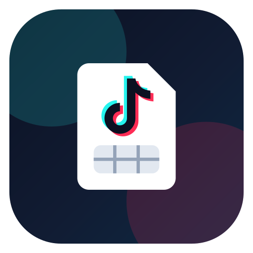
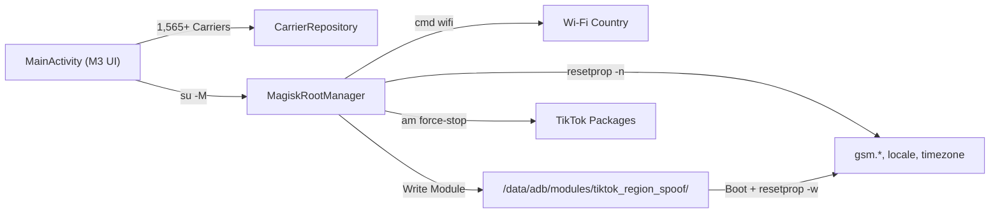

# TikTok Region Spoof

**Offline Android utility (Material Design 3 + AGP 9.5.1 built-in Kotlin) that bypasses TikTok's SIM/network region detection solely via Magisk Root (`resetprop` + persistent Magisk module) — without LSPosed, Xposed, or `INTERNET` permission.**

---

## Architecture

- **Pure Magisk Root**: Overrides `gsm.*` properties in memory with `resetprop -n`, mirrors Dual-SIM slots (`gb,gb`), and optionally installs a Magisk module (`system.prop`, `service.sh`, and PID-locked `guard.sh`) to prevent RIL/baseband resets.
- **1,565+ Operational Carriers**: Extracted from [P1sec/MCC_MNC](https://github.com/P1sec/MCC_MNC) into [`app/src/main/assets/mcc_mnc_carriers.json`](app/src/main/assets/mcc_mnc_carriers.json), defaulting to **`23415` (United Kingdom — `gb` / Vodafone UK)**.
- **Live Verification**: Compares `TelephonyManager` API values against `resetprop` outputs and warns if a physical SIM overrides `TelephonyManager`.

---

## Spoofed Signals & Targets

| Category | Targets |
| :--- | :--- |
| **SIM & Network** | `gsm.sim.operator.iso-country`, `gsm.operator.iso-country`, `gsm.sim.operator.numeric`, `gsm.operator.numeric`, `gsm.sim.operator.alpha`, `gsm.operator.alpha`, `gsm.sim.state`, `gsm.current.phone-type`, `gsm.network.type`, `gsm.operator.isroaming` |
| **Optional OS Hints** | `cmd wifi force-country-code`, `persist.sys.locale`, `ro.product.locale`, `persist.sys.timezone`, `service call alarm 3` |
| **TikTok Packages** | `com.zhiliaoapp.musically`, `com.ss.android.ugc.trill`, `com.zhiliaoapp.musically.go`, `com.ss.android.ugc.aweme`, `com.tiktok.business` |

---

## Build & Verification

| Item | Details |
| :--- | :--- |
| **Toolchain** | Gradle `9.9.1` · AGP `9.5.1` · `compileSdk = 37` · `targetSdk = 37` · `minSdk = 27` |
| **UI & Icons** | `material:1.14.0` (`DynamicColors`) · Adaptive & Monochrome Icons ([`art/ic_launcher.svg`](art/ic_launcher.svg)) |
| **Checks** | `gradle testDebugUnitTest lintDebug assembleDebug` — **6/6 unit tests passed**, **0 Lint issues** |
| **CI** | [`.github/workflows/android-ci.yml`](.github/workflows/android-ci.yml) |

---

## Usage & Real-Device Notes

1. **Pre-Grant Root in Magisk**: Modern Magisk removed runtime `su` prompts (`SuPolicy::default()` is `Deny`). Grant **TikTok Region Spoof** in **Magisk → Superuser** first (the app provides an **Open Magisk App** shortcut when ungranted).
2. **Avoid Cellular Tower Leakage**: On Android 10+ with an active SIM, `TelephonyManager.getNetworkCountryIso()` can still report the tower's country. Use **Airplane Mode + Wi-Fi** alongside a VPN/proxy in your target region.
3. **Clear TikTok App Data**: TikTok caches region/settings in `shared_prefs` / `keva`. If comments or feeds remain restricted after switching regions, clear TikTok's app data and relaunch.

> Disclaimer: Provided for research and testing purposes only.
